# TicketHub: Event Ticketing System Design

## 1. Requirements

TicketHub is a website where users discover concerts and events, select seats, purchase tickets, and view their orders. The system must support two million registered users and remain reliable when a popular event attracts a large number of buyers at once.

### Functional requirements

- Users can register, sign in, and manage their accounts.
- Users can browse, search, and view event details.
- Users can view a venue's seats and their current availability.
- Users can temporarily hold available seats while completing checkout.
- Users can pay for an order and receive confirmation when payment succeeds.
- Users can view their orders and purchased tickets.
- Users can cancel eligible orders and receive refunds according to the event's policy.
- Administrators can create events, configure venues and seats, and manage ticket availability.

### Non-functional requirements

**Speed:** Event listings and event details should normally load within two seconds. Seat availability and checkout responses should remain responsive during a major sale. These are targets to measure, not guarantees.

**Correctness:** A seat must not be sold to two buyers. An order must not be marked as paid unless the payment has been verified. Seat availability and order status must remain consistent.

**Fairness:** Buyers should be processed using a transparent, documented queue policy during exceptionally busy sales. The system should limit automated abuse and prevent one user from overwhelming the service. A queue should not promise a seat until the seat has actually been held successfully.

**Availability and recovery:** The website should continue serving event information if the checkout system is under pressure. Failed components should be recoverable, and database backups should be tested.

**Security:** Users must only access their own orders and tickets. Payment card details should be handled by a compliant payment provider rather than stored directly by TicketHub.

**Scalability:** The application should support normal demand and scale horizontally when a popular event goes on sale.

**Observability:** The system should record request latency, queue length, payment failures, seat-hold conflicts, and errors so operators can detect problems quickly.

## 2. Traffic and capacity estimates

The estimates below use the supplied figures. Where the assignment does not specify a request rate or traffic distribution, assumptions are stated explicitly.

### Normal day

- Registered users: 2,000,000.
- Daily visitors: 50,000.
- Pages viewed per visitor: 10.
- Daily page views: 50,000 × 10 = **500,000 page views**.
- Tickets sold per day: 5,000.

Assuming activity is spread across 24 hours:

500,000 ÷ 86,400 seconds ≈ **5.8 page views per second on average**.

This is only the average page-view rate. Real traffic will vary by time of day, and one page view may generate several API requests for event details, images, seat maps, and other data. Therefore, actual request traffic will be higher than the page-view rate.

### Popular concert sale

- People trying to buy tickets: 200,000.
- Seats available: 20,000.
- Time window: 10 minutes = 600 seconds.
- Average arrival rate: 200,000 ÷ 600 ≈ **333 potential buyers per second**.
- Seats available per potential buyer: 20,000 ÷ 200,000 = **0.1 seat per person**.
- Maximum proportion who can obtain one seat: 20,000 ÷ 200,000 = **10%**, assuming one seat per buyer and all seats sell.

The average arrival rate is not the maximum peak. If many people arrive at the same moment, the instantaneous rate could be considerably higher. For capacity planning, TicketHub should load-test at several multiples of the average arrival rate and use measured results to set its capacity.

### Comparison

The big sale brings approximately 333 potential buyers per second, compared with an average of 5.8 page views per second on a normal day. That is about **57 times the normal average page-view rate**, although this comparison is between potential buyer arrivals and page views, not identical request types.

The main challenge is not simply serving pages. It is coordinating thousands of competing seat reservations and payments correctly. TicketHub should cache public event information, distribute incoming traffic, place buyers in a queue when necessary, and protect the transactional database from excessive concurrent checkout requests.

## 3. API design

The API uses REST-style endpoints and JSON request and response bodies. All endpoints that modify orders or seats require authentication. The examples show the proposed API, not a deployed service.

| Method and endpoint | Purpose |
|---|---|
| `GET /api/v1/events` | Browse events, with pagination and optional search or date filters. |
| `GET /api/v1/events/{eventId}` | View event details, venue, date, and ticket information. |
| `GET /api/v1/events/{eventId}/seats` | View seats and their current availability. |
| `POST /api/v1/seat-holds` | Temporarily reserve one or more available seats for the authenticated buyer. |
| `GET /api/v1/seat-holds/{holdId}` | Check whether a hold is active or expired. |
| `POST /api/v1/orders` | Create an order from a valid seat hold. |
| `POST /api/v1/orders/{orderId}/payment` | Initiate or confirm a payment-provider checkout flow. |
| `GET /api/v1/orders` | List the authenticated user's orders. |
| `GET /api/v1/orders/{orderId}` | View one of the authenticated user's orders and its status. |
| `GET /api/v1/tickets` | View the authenticated user's issued tickets. |

### Example: hold seats

Request:

`POST /api/v1/seat-holds`

```json
{
  "eventId": "evt_123",
  "seatIds": ["seat_A10", "seat_A11"]
}
```

A successful response could be:

```json
{
  "holdId": "hold_456",
  "status": "active",
  "expiresAt": "2026-11-01T12:05:00Z"
}
```

The server must verify that every requested seat belongs to the event and is available. The hold must be created atomically: either all requested seats are held or none are. A hold expires after a short period, for example five minutes, unless checkout completes first.

If another buyer has already acquired a seat, the API should return a conflict response such as HTTP `409 Conflict`. The client must refresh availability rather than assume its previous seat map is still current.

### Example: create an order

Request:

`POST /api/v1/orders`

```json
{
  "holdId": "hold_456",
  "idempotencyKey": "checkout-request-789"
}
```

The server verifies the authenticated owner and status of the hold, then creates an order using the prices recorded by the server. The client must not be trusted to set the final price.

The idempotency key allows a repeated request to return the existing result instead of creating duplicate orders when a client retries after a timeout.

### API errors and security

The API should use consistent error responses. Common status codes include:

- `400 Bad Request`: invalid input.
- `401 Unauthorized`: the user is not authenticated.
- `403 Forbidden`: the user is not permitted to access the resource.
- `404 Not Found`: the requested event, seat, hold, or order does not exist or is not accessible.
- `409 Conflict`: a seat is no longer available or the hold has expired.
- `429 Too Many Requests`: rate limit exceeded.
- `500 Internal Server Error`: unexpected server failure.

The server must enforce ownership checks, validate input, rate-limit sensitive endpoints, and verify payment notifications using the payment provider's signature or authenticated API. A browser redirect alone is not proof of payment.

## 4. Data model

TicketHub uses a relational database such as PostgreSQL for orders, seat assignments, and other transactional records. Relational transactions and constraints help maintain correctness when requests happen concurrently.

The four core tables are `users`, `events`, `seats`, and `orders`. A `seat_holds` table is also required to represent temporary reservations, and an `order_items` table records the seats belonging to each order.

### Tables and relationships

**users**
- `id` — primary key.
- `name` — user's name.
- `email` — unique email address.
- `password_hash` — password hash, never a plaintext password.
- `created_at` — account creation timestamp.

**events**
- `id` — primary key.
- `title` — event name.
- `venue_name` — venue name.
- `starts_at` — event start time.
- `status` — for example, scheduled, on sale, or cancelled.

**seats**
- `id` — primary key.
- `event_id` — foreign key to `events.id`.
- `seat_label` — seat identifier within the event, such as `A10`.
- `price` — price in the event's currency.
- `status` — availability state, such as available, held, or sold.
- Unique constraint on (`event_id`, `seat_label`).

**orders**
- `id` — primary key.
- `user_id` — foreign key to `users.id`.
- `status` — pending payment, paid, failed, cancelled, or refunded.
- `total_amount` — total calculated by the server.
- `currency` — currency code.
- `payment_reference` — reference from the payment provider.
- `created_at` — order creation timestamp.

**seat_holds**
- `id` — primary key.
- `user_id` — foreign key to `users.id`.
- `expires_at` — expiration timestamp.
- `status` — active, converted, or expired.
- `created_at` — hold creation timestamp.

**order_items**
- `id` — primary key.
- `order_id` — foreign key to `orders.id`.
- `seat_id` — foreign key to `seats.id`.
- `price_at_purchase` — price captured for this purchase.
- A unique constraint on `seat_id` for tickets that have been sold.

The seat-hold implementation also needs a `seat_hold_items` table linking holds to seats. It should have foreign keys to `seat_holds` and `seats`, and a unique constraint on `seat_id` so the same seat cannot be actively held by two different holds. Expired holds must be released safely before a new hold is granted.

### Relationships

- One user can have many orders.
- One event can have many seats.
- One order can contain many order items.
- Each order item refers to one seat.
- One user can create many seat holds.
- One seat hold can contain many seats.

An event can be represented as having its own set of seats. If a venue has reusable physical seats across many events, each event-seat combination must still have a distinct inventory record so that the same physical seat can be sold for different event dates without mixing up their availability.

## 5. Preventing double-booking

The database, not the browser, must be the final authority on seat ownership. Two buyers may both see a seat marked as available because their pages loaded at slightly different times. That is expected in a concurrent system. What must never happen is for both buyers to successfully acquire the same seat.

### Temporary holds

When a buyer selects seats, the server begins a database transaction. It locks the requested seat rows in a consistent order, checks that the seats are available and that any previous holds have expired, and creates the hold records. It commits only if all requested seats can be held; otherwise it rolls back the transaction.

A short expiration time prevents abandoned checkout sessions from blocking inventory indefinitely. Expired holds must be released through a safe, repeatable process. The hold's owner, status, and expiration must be checked again when the order is created.

### Transactions and constraints

A transaction groups multiple database changes into one unit. If one required change fails, the transaction can roll back rather than leave only part of the operation completed.

The database should enforce the following protections:

1. Lock seat rows during hold creation, or use an equivalent atomic conditional update.
2. Use a unique constraint to prevent duplicate sold-seat assignments.
3. Ensure the hold-to-seat relationship cannot assign the same seat to multiple active holds.
4. Use conditional updates that only change a seat from available to held if it is still available.
5. Create the order and convert the hold consistently, within a transaction.
6. Make payment processing idempotent so retries cannot create duplicate purchases.

For example, a conditional update might be:

```sql
UPDATE seats
SET status = 'held'
WHERE id = :seat_id
  AND status = 'available';
```

The server must check the number of rows affected. If it is not exactly one for each requested seat, it must not claim that the hold succeeded. For multiple seats, all required changes must be handled within one transaction, with rollback if any seat cannot be acquired.

### Handling payment safely

A payment provider may take several seconds to respond, and the response may be delayed or repeated. TicketHub should not keep a database transaction open while waiting for an external payment network.

Instead, TicketHub creates a pending order from a valid hold, initiates payment with an idempotency key, and processes the verified payment result. The system then marks the order paid and converts the seat assignment to sold within a database transaction, provided the order and hold still satisfy the purchase rules.

The design must define how long the hold remains valid during payment. If the payment succeeds after the hold has expired or inventory has been released, the system must not sell the seat to the late payment. It should use a defined recovery process, such as retrying a safe reservation when possible or issuing a refund. Payment webhooks must be verified and handled idempotently.

These controls ensure that simultaneous requests may compete, but only one valid transaction can secure a particular seat.

## 6. Architecture and handling the big sale

```mermaid
flowchart TD
    U[Buyers] --> CDN[CDN and cached public content]
    CDN --> WAF[WAF and rate limiting]
    WAF --> LB[Load balancer]
    LB --> WEB[Stateless web/API servers]
    WEB --> CACHE[Shared cache for event data]
    WEB --> QUEUE[Virtual waiting room]
    QUEUE --> API[Admission-controlled checkout API]
    API --> DB[(Transactional relational database)]
    API --> PAY[External payment provider]
    PAY --> HOOK[Verified payment webhook]
    HOOK --> API
    DB --> WORKER[Background workers]
    WORKER --> DB
    DB --> REPLICA[(Read replica for suitable reads)]
    DB --> BACKUP[Automated backups]
    WEB --> MON[Logs, metrics and alerts]
    API --> MON
    DB --> MON
```



### Components

**CDN and cached public content:** Serves static files and cacheable event information close to users. It reduces load on the application servers. Seat availability and checkout decisions must not rely on stale cached data.

**Web application firewall and rate limiting:** Blocks common malicious traffic and limits abusive request rates. It reduces abuse but cannot by itself guarantee fair access.

**Load balancer:** Distributes requests across healthy application instances and removes unhealthy instances from service.

**Stateless web/API servers:** Handle browsing, authentication, seat-hold requests, order creation, and ticket access. Multiple instances can be added when demand increases.

**Shared cache:** Stores frequently requested public event data and other safe-to-cache information. It should not replace database transactions for seat ownership.

**Virtual waiting room:** Queues buyers when demand exceeds the safe checkout capacity. Admission should follow a published, consistent policy, such as arrival order with abuse controls. The queue limits how many buyers reach the transactional system simultaneously.

**Admission-controlled checkout API:** Applies limits to seat holds and checkout requests. It verifies the user, hold, and order state before making changes.

**Transactional relational database:** Stores authoritative seat inventory, holds, orders, and payment state. Row-level locks, transactions, foreign keys, and unique constraints protect correctness.

**Payment provider:** Handles payment processing. TicketHub stores payment references and relevant status, not raw card details.

**Verified payment webhook:** Receives payment status updates, verifies their authenticity, and safely updates order status. Duplicate notifications must not duplicate purchases.

**Background workers:** Expire abandoned holds, process notifications, reconcile payment results, and perform other work outside the immediate request path.

**Read replica:** Serves suitable read-heavy queries, such as some reporting or browsing operations. The primary database remains authoritative for holds and purchases. Replica lag means it should not be used to confirm that a seat can be purchased.

**Backups, monitoring, and alerts:** Backups support recovery. Monitoring tracks queue depth, API latency, database locks, rejected holds, payment failures, and error rates.

### Big-sale operating strategy

Before a major sale, TicketHub should test the full purchase flow under load, pre-warm safe caches, verify database capacity, and prepare queue limits and operational alerts. During the sale, the waiting room regulates admission so the database is not overwhelmed by all 200,000 potential buyers at once.

Public event data can be served from the CDN and cache, but each seat hold must still be validated against authoritative inventory. If checkout is overloaded, TicketHub should slow admissions and return clear queue or retry information rather than silently accepting unsafe purchases. After the sale, background jobs can process notifications and reporting without delaying checkout.

The system should be load-tested with bursts and competing requests for the same seat. Capacity limits should be based on those measured tests, not on average traffic alone.

## 7. Trade-offs

### Trade-off 1: Strong correctness versus checkout throughput

Row locks and transactional constraints protect seat inventory, but they can make requests slower when many buyers compete for the same seats. TicketHub should accept some waiting and conflicts rather than risk double-booking. Consistent lock ordering, short transactions, and a waiting room reduce unnecessary contention.

### Trade-off 2: Fairness versus maximum speed

A virtual waiting room adds a step and can make some users wait longer, but it gives the service a controlled way to admit buyers during a surge. A simple first-come-first-served queue is understandable, although network latency and automated clients can complicate fairness. TicketHub should publish the admission policy and apply abuse controls consistently.

### Trade-off 3: Caching versus fresh availability

Caching makes event pages faster and reduces database load, but cached seat maps may be out of date. TicketHub should cache public event descriptions while checking current inventory in the transactional database before granting a hold.

### Trade-off 4: Temporary holds versus inventory utilization

Holds give buyers time to complete checkout, but abandoned sessions temporarily make seats unavailable. Short expirations improve inventory utilization but may inconvenience buyers during slow payment flows. The expiration period should be measured and clearly communicated, with a safe process for delayed payment results.

## Conclusion

TicketHub can serve normal browsing traffic efficiently while protecting the most sensitive operation: assigning a seat to a buyer. Caching and horizontal scaling help with public traffic, a virtual waiting room controls surges, and database transactions and constraints enforce single-seat ownership. Payment verification, idempotency, monitoring, and recovery procedures complete the design.
